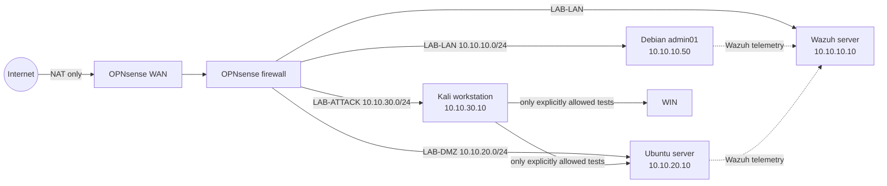

# Cybersecurity Home Lab

> A safe, repeatable, portfolio-ready environment for learning network defense, endpoint telemetry, detection engineering, incident response, and ethical security testing.

## Project status

**WORK IN PROGRESS — public source and documentation snapshot; not a completed lab.**

See [backup scope](BACKUP-SCOPE.md) before restoring this source snapshot.

**Phase 1 in progress — Segmented network, Wazuh central server, two Linux agents, the Kali ATTACK workstation, and the first detection exercise validated.** OPNsense `26.1.6_2` provides named LAN/DMZ/ATTACK interfaces and logged inter-zone controls. Debian 13 `admin01` administers the lab from LAN, Ubuntu Server 24.04.4 LTS `ubuntu-01` operates in DMZ under a tested minimum-access policy, the all-in-one Wazuh server `siem01` is active at `10.10.10.10`, and Kali Linux 2026.2 `kali-01` is validated at `10.10.30.10` on the isolated ATTACK segment. Wazuh reports both approved endpoints active and none disconnected; [DET-001](evidence/2026-07-31_DET-001_failed-ssh-login.md) proves the SSH authentication-alert pipeline. The Kali cold baseline snapshot and later detection exercises remain planned.

## What this lab demonstrates

- Network segmentation and firewall administration with OPNsense
- Windows and Linux endpoint hardening
- Centralized security monitoring with Wazuh
- Safe attack simulation from Kali Linux
- Alert triage, detection tuning, and incident reporting
- Change control, troubleshooting, and evidence-based documentation

## Architecture

The virtual networks are isolated from the home LAN. OPNsense is the only lab system with an internet-facing adapter, and that adapter uses hypervisor NAT—not bridged mode.

## Start here

1. Read [scope, ethics, and safety](docs/00-scope-safety.md).
2. Run the [host readiness check](scripts/windows/Test-LabReadiness.ps1).
   The current sanitized result is recorded in the [host readiness record](docs/10-host-readiness.md).
3. Choose a [hardware profile and architecture](docs/01-architecture.md).
4. Follow the [portfolio-style all-in-one build guide](docs/15-all-in-one-home-lab-build-guide.md).
   The original phased [build guide](docs/02-build-guide.md) and its acceptance tests remain available as a detailed source record.
   Current implementation records: [OPNsense firewall](docs/11-opnsense-build-record.md), [admin01 management VM](docs/12-admin01-build-record.md), [ubuntu-01 DMZ server](docs/13-ubuntu01-build-record.md), [siem01 Wazuh server](docs/14-siem01-build-record.md), and [kali-01 ATTACK workstation](docs/16-kali01-build-record.md).
5. Establish [logging and detections](docs/03-monitoring-detection.md).
6. Begin the [90-day practice plan](docs/05-90-day-learning-plan.md).
7. Publish only sanitized material using the [portfolio guide](docs/07-portfolio-guide.md).

New terminology is explained in the [beginner glossary](docs/09-glossary.md).

## Repository map

| Path | Purpose |
|---|---|
| `docs/` | Architecture, build, operations, exercises, and career presentation |
| `templates/` | Daily logs, change records, incident reports, and project case studies |
| `scripts/` | Host readiness, evidence collection, and repository validation |
| `evidence/` | Sanitized screenshots, command output, diagrams, and reports |
| `configs/` | Version-controlled, non-secret configuration examples |

## Definition of done

The initial lab build is complete only when every acceptance test in the build guide passes, both agents report to Wazuh, the first three detection exercises produce documented alerts, a restore test succeeds, and no secrets or personal data are present in the repository.

## Safety boundary

This project is for systems you own or have explicit permission to test. Never bridge an intentionally vulnerable machine to a physical network, expose it to the public internet, or use the exercises against third parties. See [SECURITY.md](SECURITY.md) before sharing evidence.

## License

Documentation and original code are provided under the [MIT License](LICENSE). Third-party software retains its own license.

